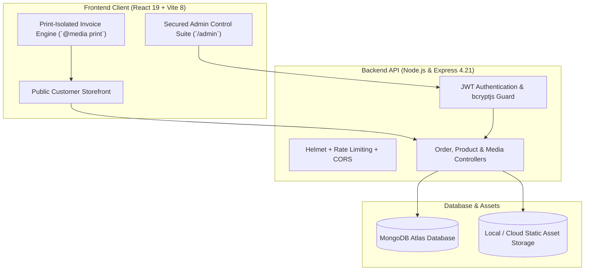

<div align="center">

# Ammwala — Agro & Organic Food E-Commerce Platform
### Enterprise Agro & Organic Pre-Booking E-Commerce Ecosystem

[](https://nodejs.org)
[](https://react.dev)
[](https://vitejs.dev)
[](https://tailwindcss.com)
[](https://expressjs.com)
[](https://mongodb.com)

**A high-performance, full-stack seasonal agro & organic product e-commerce ecosystem designed for high-conversion pre-bookings, flexible delivery management, and real-time storefront administration.**

[Key Features](#core-features) · [Architecture](#system-architecture) · [Getting Started](#getting-started) · [Security & Hardening](#security--hardening) · [Admin Credentials](#admin-credentials) · [License](#license--authorship)

---

</div>

## Overview

**Ammwala** is a specialized full-stack web application built to solve the operational and conversion bottlenecks of seasonal organic food and agro-product businesses. Tailored for bulk harvesting logistics (such as Rajshahi/Chapai mangoes, raw organic honey, seasonal fruits, and cold-pressed oils), it combines frictionless pre-ordering with powerful administrative delivery controls and thermal/print invoice generation.

---

## Core Features

### 1. High-Converting Storefront
- **Clean Semantic Routing & SEO URLs:**
  - Product pages use dynamic slugs (e.g., `/product/himshagar`, `/product/amrapali`) instead of raw database IDs.
  - Smooth section scrolling without hash fragments (`#varieties`, `#about`, `#order`) in the browser URL bar.
- **Customizable Delivery Location & Free Delivery Engine:**
  - Dynamic location selector on product landing pages: *Inside Dhaka* & *Outside Dhaka*.
  - **Free Delivery Override:** Individual products can be set to 100% Free Delivery from admin, displaying prominent free shipping badges and automatically setting delivery fees to ৳0 in cart and invoice calculations.
- **Dynamic 1-Page Customer Invoice (`OrderInvoiceModal`):**
  - Instantly generates an official customer invoice with transaction ID, customer contact, delivery schedule, itemized billing, and brand logo.
  - **Print Isolation Technology:** Enforces exact single-page print rendering via CSS `@media print` and React portals, stripping background noise and preventing multi-page overflow.
- **Interactive Product Details:**
  - Weight and package pricing toggles (e.g., 5kg, 10kg, 20kg crates).
  - High-res product media showcase with sticky pre-booking action bars for mobile shoppers.

### 2. Real-Time Administrative Suite (`/admin`)
- **Executive Metric Cards:** Real-time visibility into Gross Sales, Confirmed Bookings, Pending Verifications, and Active Inventory Levels.
- **Full Order Lifecycle Management:**
  - Status pipeline: `Pending` -> `Confirmed` -> `Processing` -> `Shipped` -> `Delivered` -> `Cancelled`.
  - Inline order detail inspection, delivery fee recalculation, and 1-click invoice printing.
- **Product & Category Governance:**
  - Add, update, and toggle active status on varieties, inventory tiers, and seasonal batch availability.
- **Media Asset Manager:** Seamless product photography uploads with automatic image optimization.

---

## System Architecture



---

## Security & Hardening

- **Stateless JWT Authentication:** Administrative routes guarded with bearer tokens and httpOnly cookie fallback.
- **Rate Limiting:** Protects order placement and login endpoints against brute-force attacks (`express-rate-limit`).
- **HTTP Header Protection:** Pre-configured with `helmet` for secure CSP, HSTS, and XSS filtering.
- **Input Sanitization:** Express-validator and Mongoose schema sanitization on all transactional inputs.

---

## Getting Started

### Prerequisites
- Node.js `>= 18.x`
- MongoDB (Local instance or MongoDB Atlas connection URI)
- NPM `>= 9.x`

### Installation

```bash
# 1. Clone repository
git clone https://github.com/alramim07/organic-product-ecommerce-.git
cd organic-product-ecommerce-

# 2. Install backend dependencies
cd backend
npm install

# 3. Install frontend dependencies
cd ../frontend
npm install
```

### Environment Setup

**Backend (`backend/.env`):**
```env
PORT=5000
MONGODB_URI=your_mongodb_connection_string
JWT_SECRET=your_jwt_secure_secret_key
ADMIN_EMAIL=admin@test.com
ADMIN_PASSWORD=Test123@#
FRONTEND_URL=http://localhost:5173
```

**Frontend (`frontend/.env`):**
```env
VITE_API_URL=http://localhost:5000
```

### Running Development Servers

```bash
# Terminal 1 - Backend (port 5000)
cd backend
npm run dev

# Terminal 2 - Frontend (port 5173)
cd frontend
npm run dev
```

Access the applications at:
- **Customer Storefront:** `http://localhost:5173`
- **Admin Management Portal:** `http://localhost:5173/admin/login`

---

## Admin Credentials (Local Testing)

| Parameter | Details |
| :--- | :--- |
| **Admin Portal URL** | `http://localhost:5173/admin/login` |
| **Default Email** | `admin@test.com` |
| **Default Password** | `Test123@#` |
| **Default Role** | `superadmin` |

*(Note: Admin password can be changed securely anytime from the Admin Dashboard).*

---

## Production Build

```bash
# Build frontend for production
cd frontend
npm run build
```

The output will be generated inside the `frontend/dist/` directory, ready for deployment on Netlify, Vercel, or Nginx.

---

## License & Authorship

Developed and maintained by **Al Ramim** ([@alramim07](https://github.com/alramim07)).  
All source code, design architecture, and implementation rights are retained by the author. Distributed under the **MIT License**.
